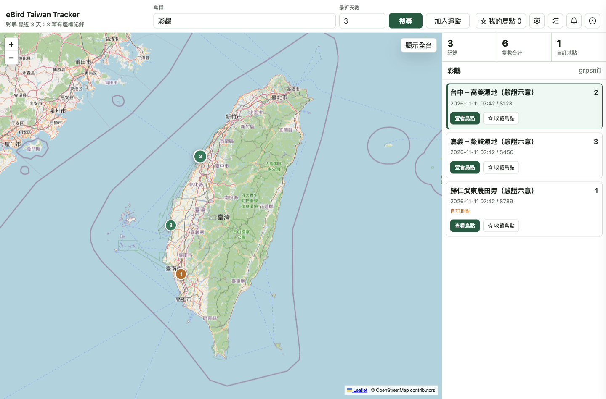
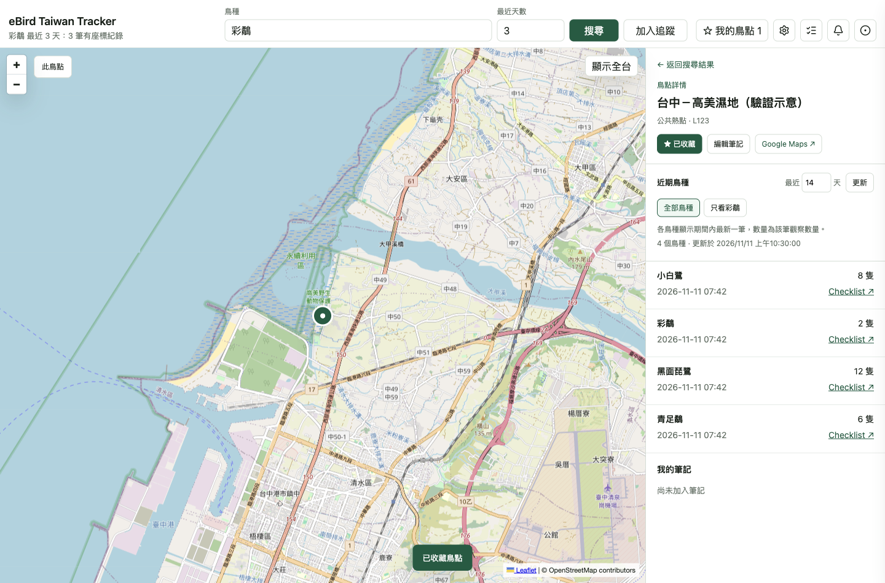
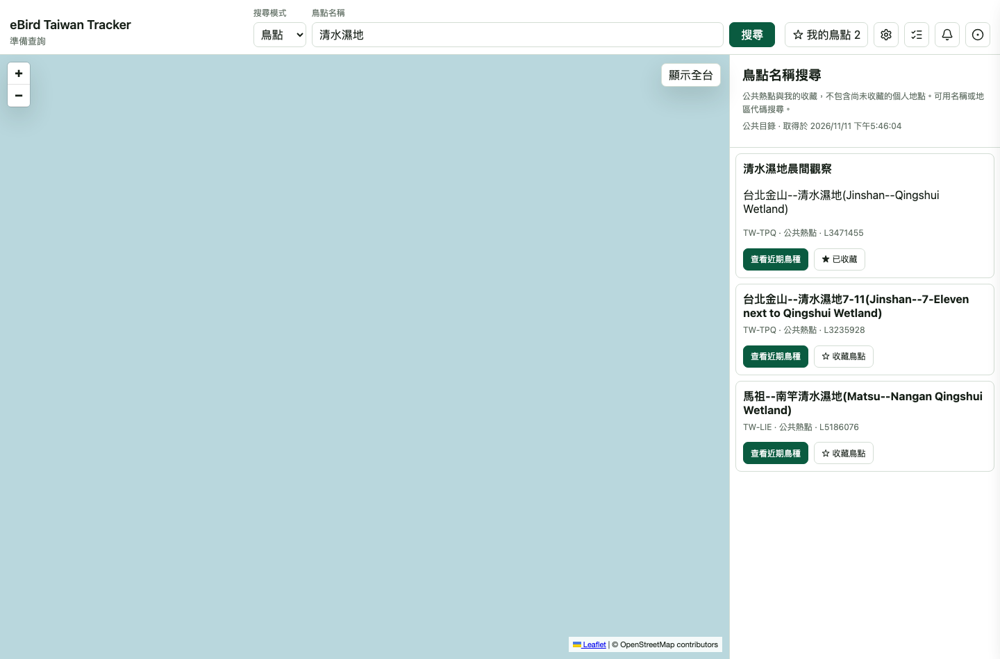
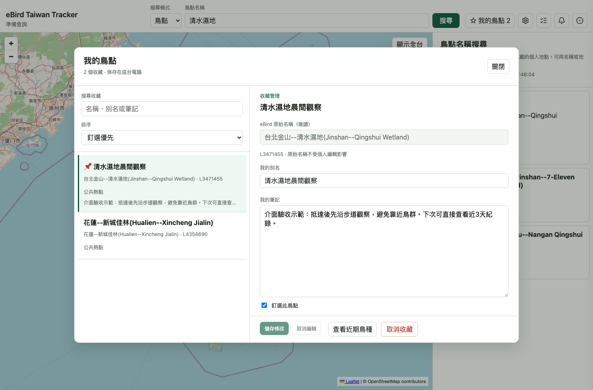
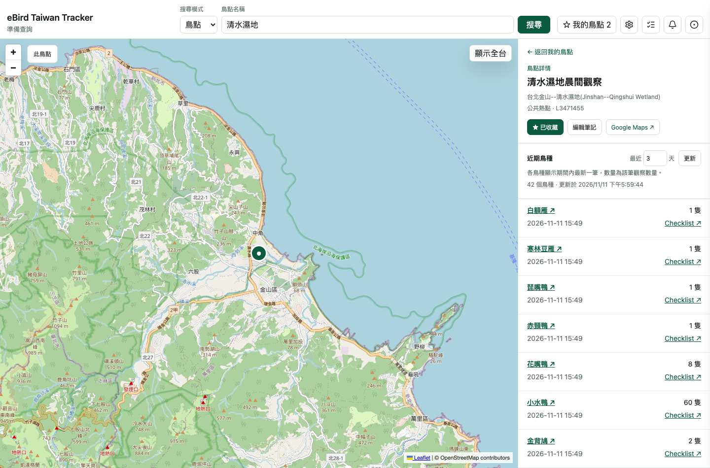

# Desktop 鳥點收藏與近期鳥種

本文件對應 issue #32、#34。Desktop 與本機 Web 在既有工具列、左地圖及右清單接入鳥點功能。資料查詢、收藏保存與公共目錄沿用 #30、#31、#33 的共用契約。

## 從觀察紀錄查看或收藏鳥點

觀察卡與 marker popup 都有「查看鳥點」和「收藏鳥點」。同一 `locId` 共用收藏狀態。只有持久保存成功才顯示已收藏；寫入失敗保留原狀態及重試入口。取消收藏後提供八秒復原，復原遵守保存契約，不覆寫重新收藏後較新的筆記。

缺少有效 `locId` 的舊通知或快取紀錄會顯示重新搜尋提示，不從名稱或座標推測地點。

## 鳥點詳情與返回

點「查看鳥點」後，右側改為指定鳥點的近期鳥種。預設 3 天，可設 1–30 天。每次從紀錄卡、popup 或收藏重新進入鳥點，都明確以 3 天查詢；底層 API 省略 days 時的既有 14 天預設不變。從鳥種紀錄進入時，可選全部鳥種或只看原鳥種；從收藏進入時不套用不相關的鳥種篩選。

每個鳥種顯示期間內最新一筆觀察、該筆數量、時間及 Checklist。鳥種名稱連到對應 speciesCode 的 eBird 鳥種專頁，另開頁面；中文名缺失時仍以學名或 speciesCode 作為可點名稱。這不是完整歷史，不將各筆數量加總成期間鳥數。最新成功回應顯示取得時間；重新查詢時清除先前結果，不把舊資料當作新資料。載入、空結果、地點不可取得與網路失敗分開呈現。

地圖暫時隱藏原鳥種 markers，只顯示指定鳥點的一個 marker。名稱缺失時使用地點 ID；座標缺失時仍可看紀錄，但不建立假位置，也不查周邊替代。上游提供的同一地點資料可補足缺失的名稱、位置或類型。API 未提供地區欄位時不自行推測行政區。

原搜尋結果保持掛載。進入詳情前先保存地圖視野和清單捲動位置，返回時恢復選取、捲動與視野，不重新請求鳥種資料，也不推進 Search Baseline。新搜尋或通知改變結果時，以新結果為準，不再恢復過時的詳情 snapshot。

## 名稱搜尋

工具列的「搜尋模式」可切換鳥種與鳥點。兩種模式保留各自輸入；鳥種模式的最近天數不影響鳥點名稱搜尋。鳥點模式隱藏觀察天數與加入追蹤，透過本機 Node 的 `GET /api/bird-spots/search?q=...` 搜尋公共熱點和自己的收藏。私人別名與筆記不傳到 Worker。

結果以 `locId` 區分同名地點，顯示原名、可用的英文名稱、上游地區代碼、地點類型及目前收藏狀態。eBird 目錄目前提供地區代碼，沒有中文縣市對照，因此輸入提示不承諾中文縣市搜尋。個人地點只涵蓋自己的收藏。每個結果可直接收藏或查看近期鳥種，返回後保留名稱條件和清單位置。

公共目錄顯示 fresh、stale 或 unavailable 的對應文字及實際取得時間。無快取時明確標示尚無取得時間；上游失敗仍可搜尋收藏。整個搜尋請求失敗時，畫面改用已載入的本機收藏，並顯示重試入口。新查詢中止先前請求，舊回應不會覆蓋新結果。切換至鳥點模式也會取消尚未完成的鳥種搜尋，避免它稍後替換工作區。

## 我的鳥點與筆記

右上「我的鳥點」開啟較寬的管理視窗。左側搜尋收藏，提供釘選優先、最近收藏及名稱排序。右側顯示唯讀的 eBird 原始名稱，可編輯個人別名、筆記及釘選。儲存一次提交這三個欄位；別名不改 eBird 原名。排序讀取持久保存的別名、釘選及收藏時間，重新啟動預設釘選優先；所選排序保留在目前頁面的管理 session。

切換收藏、查看近期鳥種、關閉管理、取消編輯或取消收藏時，未儲存修改會提供「儲存並繼續」、「捨棄修改」、「繼續編輯」。儲存失敗保留欄位與原本目的地，可再儲存重試。較早的保存完成不清除之後新增的文字；後續文字仍需儲存。取消收藏後提供八秒復原，包含原本的個人欄位。

管理視窗往返近期詳情保留搜尋、排序、選取與捲動位置，詳情返回入口標示「返回我的鳥點」。關閉管理回到原先工作區。Escape 與背景點擊使用相同的離開確認；焦點限制涵蓋按鈕、輸入、文字區與排序，關閉後返回先前控制項。左側搜尋與排序固定，只有收藏清單獨立捲動。右側表單依可用高度配置，四個操作固定在底部；一般高度不需捲動，較矮視窗只讓欄位區捲動，底部操作不會被截斷。

詳情仍提供小型筆記編輯器。點「編輯筆記」會將文字區捲入可見範圍並聚焦，即使鳥點有數十個鳥種也能直接輸入。重複點編輯不清除草稿；保存失敗保留草稿。顯式返回、進我的鳥點、取消編輯、取消收藏、提交新搜尋或選取通知，使用相同的三選項離開確認。

外部已完成的搜尋不被草稿阻擋；詳情與管理草稿按 `locId` 保留在目前頁面的記憶體中，重新打開可繼續編輯。使用者選取通知時，未儲存修改同樣先選擇儲存、捨棄或繼續編輯；已有儲存中的離開動作時不替換其目的地。保存回應只影響相同鳥點、相同編輯 revision；較舊回應不清除新文字、另一鳥點或重開 session 的草稿。草稿不承諾在關閉 app 後保存。

Desktop 與 Search App 的鳥點收藏各自保存在本機，不提供匯入、匯出或跨裝置同步。

## 版面與驗證

右上主要按鈕與搜尋輸入框底部對齊。900px 與 1440px browser 檢查沒有頁面水平溢出；管理版面另以 1440 × 950、1280 × 820、900 × 650 及 80 個收藏驗證獨立捲動與四個按鈕的完整邊界。窄視窗工作區採上下內容排列，地圖不覆蓋詳情返回按鈕；900 × 650 的管理往返使用一般點擊驗證。

`e2e/desktop-bird-spots.spec.mjs` 涵蓋紀錄卡與 popup 同步、原清單及地圖還原、Search Baseline 不變、3 天詳情預設、鳥種連結、缺 ID、缺座標、空結果及上游錯誤。名稱搜尋案例涵蓋模式條件、同名不同 ID、地區和英文名、fresh／stale／unavailable、完全離線的收藏查詢及舊回應競態。

管理案例逐一操作關閉、切換、查看詳情、取消收藏、取消編輯的三個選擇，並驗證失敗重試、保存中繼續輸入、初始選取後篩選或排序、管理往返位置、重載後欄位及三種排序。既有詳情草稿的通知、跨鳥點及重開 session 競態也持續回歸。這些 browser 案例使用攔截的示意 API 回應，不代表即時 eBird 資料。

本文件的 #32 原始畫面均取自實際啟動的 Electron UI，使用這個 worktree 的隔離 user-data、假 key 與攔截的示意觀察回應。它們是功能畫面，並非 prototype 圖片，也不代表即時 eBird 觀察。驗證後已關閉該 Electron 程序。真實上游端點另由 #30 的 opt-in integration 和 root 的 native live check 驗證；本截圖不攜帶私人設定或憑證。

重跑完整檢查：`npm run check:all`。只重跑 Desktop 行為：`npx playwright test --config playwright.desktop.config.mjs`。

### #34 實際資料驗證

2026-11-11 啟動原生 Electron，使用先前測試資料的獨立副本，原有 profile 保留。實際操作清水濕地名稱搜尋、收藏、別名／筆記／釘選、三選項離開確認、儲存後關閉、取消收藏與復原、管理與詳情往返及 app 重啟；持久資料仍正確。該次查詢近3天取得42個鳥種，鳥種名稱連至 eBird 專頁。此數量為當次上游回應，不保證之後相同。

本頁新增三張 live 圖片取自本機 Web，連接同一個 Electron Node backend 與即時 eBird 資料。它們與原生 Electron 共用 React 實作；原生版另已實際觀察右側固定操作列完整顯示且不需整區捲動。圖片中的清水濕地別名與筆記是本次驗收示範，不是使用者私人筆記。
