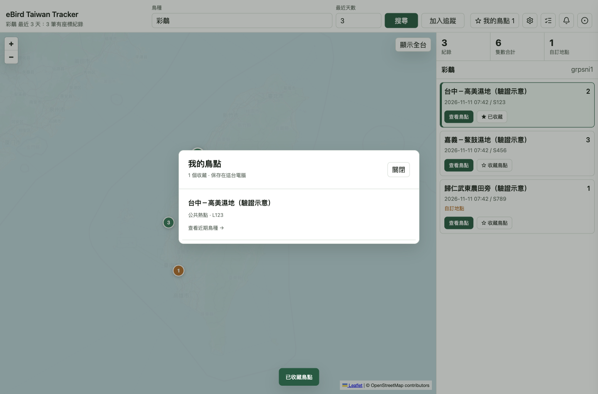

# Desktop 鳥點收藏與近期鳥種

本文件對應 issue #32。Desktop 與本機 Web 在既有工具列、左地圖及右清單接入鳥點功能。資料查詢和收藏保存沿用 #30、#31 的共用契約。

## 從觀察紀錄查看或收藏鳥點

觀察卡與 marker popup 都有「查看鳥點」和「收藏鳥點」。同一 `locId` 共用收藏狀態。只有持久保存成功才顯示已收藏；寫入失敗保留原狀態及重試入口。取消收藏後提供八秒復原，復原遵守保存契約，不覆寫重新收藏後較新的筆記。

缺少有效 `locId` 的舊通知或快取紀錄會顯示重新搜尋提示，不從名稱或座標推測地點。

## 鳥點詳情與返回

點「查看鳥點」後，右側改為指定鳥點的近期鳥種。預設 3 天，可設 1–30 天。每次從紀錄卡、popup 或收藏重新進入鳥點，都明確以 3 天查詢；底層 API 省略 days 時的既有 14 天預設不變。從鳥種紀錄進入時，可選全部鳥種或只看原鳥種；從收藏進入時不套用不相關的鳥種篩選。

每個鳥種顯示期間內最新一筆觀察、該筆數量、時間及 Checklist。鳥種名稱連到對應 speciesCode 的 eBird 鳥種專頁，另開頁面；中文名缺失時仍以學名或 speciesCode 作為可點名稱。這不是完整歷史，不將各筆數量加總成期間鳥數。最新成功回應顯示取得時間；重新查詢時清除先前結果，不把舊資料當作新資料。載入、空結果、地點不可取得與網路失敗分開呈現。

地圖暫時隱藏原鳥種 markers，只顯示指定鳥點的一個 marker。名稱缺失時使用地點 ID；座標缺失時仍可看紀錄，但不建立假位置，也不查周邊替代。上游提供的同一地點資料可補足缺失的名稱、位置或類型。API 未提供地區欄位時不自行推測行政區。

原搜尋結果保持掛載。進入詳情前先保存地圖視野和清單捲動位置，返回時恢復選取、捲動與視野，不重新請求鳥種資料，也不推進 Search Baseline。新搜尋或通知改變結果時，以新結果為準，不再恢復過時的詳情 snapshot。

## 我的鳥點與筆記

右上「我的鳥點」提供最小收藏清單，可重新開啟近期詳情，並返回收藏清單。對話框支援 Escape、焦點限制與關閉後的焦點返回。

本票只交付收藏清單及詳情內的小型筆記編輯器。完整別名管理、搜尋、排序控制與匯入匯出由後續票提供。

點「編輯筆記」會將文字區捲入可見範圍並聚焦，即使鳥點有數十個鳥種也能直接輸入。重複點編輯不清除草稿；保存失敗保留草稿。顯式返回、進我的鳥點或提交新搜尋時，未儲存變更可取消離開。

已完成的搜尋與通知不被草稿阻擋；草稿按 `locId` 保留在目前頁面的記憶體中，重新打開該鳥點可繼續編輯。儲存完成只關閉相同鳥點、相同編輯 revision 的草稿，之後新增的文字、另一鳥點的草稿，以及取消後重開的編輯 session 都不受較舊儲存回應影響。草稿不承諾在關閉 app 後保存。

## 版面與驗證

右上主要按鈕與搜尋輸入框底部對齊。新增工具列欄寬設定放在原有 responsive media rule 之前，保留 900px 視窗的既有單欄工具列。另以水平方向的 clip 包含原本移出畫面的關閉 drawer，避免它們在窄視窗產生頁面水平捲動；原有垂直捲動、搜尋建議與開啟的 dialogs 不變。

`e2e/desktop-bird-spots.spec.mjs` 覆蓋 popup／紀錄卡收藏同步、筆記與復原、返回時原結果／選取／清單位置／地圖視野、Search Baseline 不變、舊紀錄 ID、保存失敗、舊請求、缺座標、空結果及上游錯誤。後續回歸案例涵蓋長清單編輯焦點、重複編輯、取消離開、儲存後繼續輸入、跨鳥點及重開 session 的舊回應，以及強制通知保留草稿。

900px 與 1440px browser 檢查沒有頁面水平溢出，控制列對齊；900 × 600 可垂直捲動，設定 drawer、收藏 dialog 和搜尋建議仍能正常顯示。Desktop browser config 現在包含全部 `desktop-*.spec.mjs`，Search App config 明確排除它們。

本文件三張畫面均取自實際啟動的 Electron UI，使用這個 worktree 的隔離 user-data、假 key 與攔截的示意觀察回應。它們是功能畫面，並非 prototype 圖片，也不代表即時 eBird 觀察。驗證後已關閉該 Electron 程序。真實上游端點另由 #30 的 opt-in integration 和 root 的 native live check 驗證；本截圖不攜帶私人設定或憑證。

重跑完整檢查：`npm run check:all`。只重跑 Desktop 行為：`npx playwright test --config playwright.desktop.config.mjs`。
