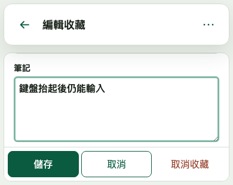
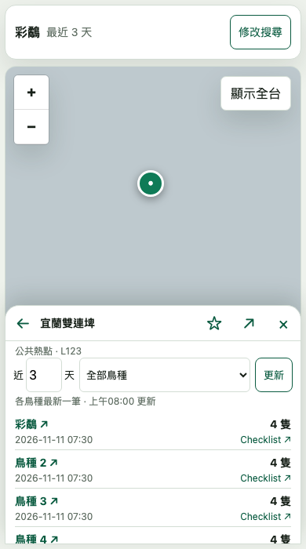

# 手機可視區域修正

#52 對應 2026-11-12 的 iPhone Safari 實機回報。使用者看到頁面空間偏小、鍵盤開啟後別名輸入框被遮住，以及鳥點 marker 落在半屏詳情後面。

## 原因與修正

手機工作區原本將 12px 外距加在 safe area inset 上。現在各邊使用 `max(6px, safe-area-inset)`，保留必要的安全邊界，同時減少額外內縮；卡片之間的間隔由 12px 改為 8px。

收藏管理原本隨 visualViewport 的高度與頂部位移調整容器，卻沒有在容器縮短後將目前輸入框捲入欄位區。現在 viewport resize、scroll 及輸入焦點變化後，都只調整欄位區的捲動位置，讓正在輸入的欄位顯示在固定操作列上方。欄位標籤不因 flex 壓縮而互相重疊。可視高度低於 480px 時，儲存、取消與取消收藏在同一列，保留每個操作至少 44px 高度，提供較多輸入空間。

鳥點 marker 原本以完整地圖置中。手機現在以地圖與浮出清單的實際幾何位置計算未被遮住的地圖區域，將 marker 移到該區域中央。搜尋條件展開／收合、清單高度與地圖尺寸變化時會重新計算。手動平移地圖不會觸發持續置中。完全展開清單只剩很窄的地圖邊緣時不強制平移；縮回半屏後再定位。返回來源仍還原原本的地圖狀態。

收藏保存、API key 邊界、查詢參數與 Desktop 排版均未改變。

## 回歸證據

新增的 5 個 headless 測試先在修正前失敗。320、390、402px 的外側間距為 12px；在 visualViewport 高度 352px、頂部位移 130px 的模型中，別名輸入框不在欄位可視區；marker 被半屏詳情遮住。修正後相同 5 個測試通過。

鍵盤測試依序驗證別名焦點、viewport resize／scroll、切換筆記焦點、310px 可視高度與 180px 位移、輸入、恢復高度及儲存。marker 測試驗證半屏、搜尋條件展開／收合、尺寸改變，以及詳情展開後縮回、收合後重開。

這些是 headless Chromium 的 DOM 幾何與 visualViewport 模型，沒有開啟可見視窗、原生 Electron 或實際 iOS 鍵盤。圖磚均為本機 PNG fixture，API 為受控回應。實際 Safari 的鍵盤動畫、瀏覽器工具列與安全區仍需同一手機網址複驗。

完整檢查通過。型別及兩版 build、121 項 Node、16 項 Worker、4 項 bundle、75 項 Search browser、54 項 Desktop Web browser 均通過。Search browser 使用隔離 Worker 7309 的暫存 config，預設 7082 與手機 7310 預覽未被取代。執行各 `check:all` 階段的命令及結果保存在 ticket-52 的 `.local/issue-52/`；沒有使用真實 API key。

