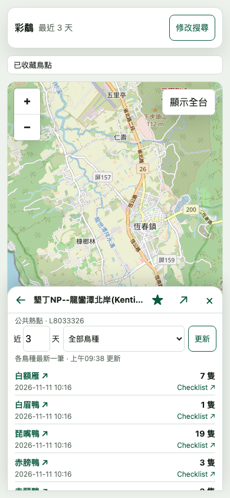
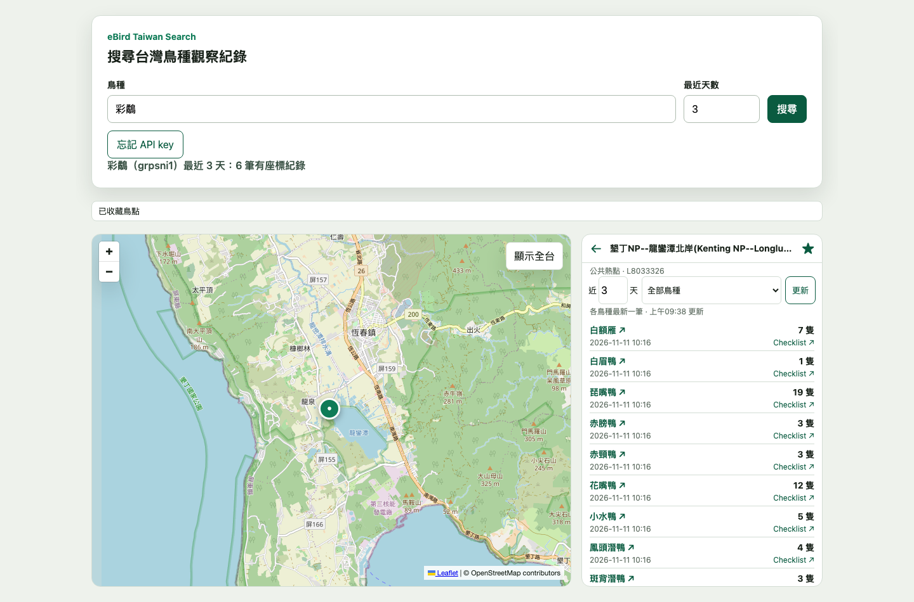
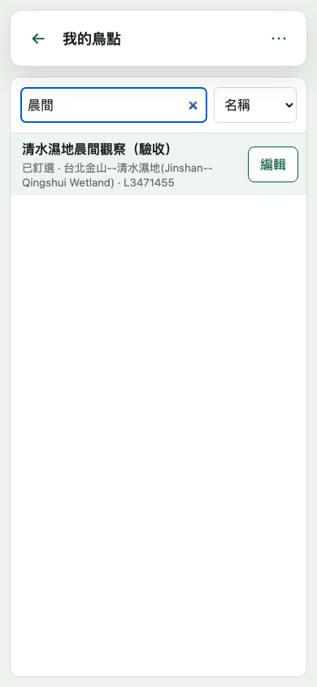
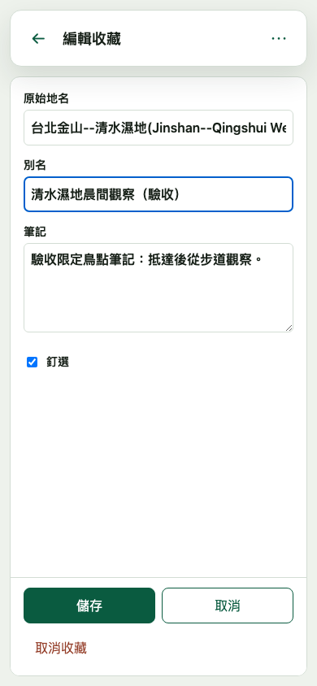
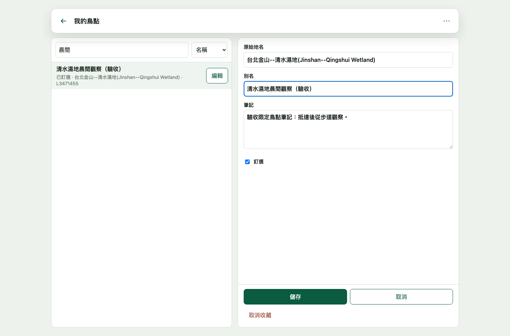

# Search App 鳥點搜尋與收藏

Search App 從選取的鳥種觀察紀錄提供鳥點詳情與收藏。點地名旁的 › 開啟詳情，同列星號收藏或取消收藏。Checklist 與 Google Maps 保留為紀錄卡的主要外部操作。

## 搜尋鳥點名稱

展開搜尋條件，選「鳥點」，輸入地名、地區代碼、收藏別名或筆記後搜尋。兩個模式各自保留輸入。鳥種搜尋使用最近天數，鳥點名稱搜尋涵蓋公共熱點與這個瀏覽器的收藏。

Search App 以 `GET /api/bird-spots/directory` 取得公共目錄。瀏覽器將公共目錄與 IndexedDB 收藏依 `locId` 合併，再比對輸入的文字。別名、筆記與鳥點搜尋詞留在瀏覽器。結果以地區、類型與 ID 區分同名鳥點。讀取公共目錄期間即可查看符合的本機收藏。公共目錄更新失敗時，畫面顯示舊目錄的更新時間或告知目前只搜尋本機收藏。

## 我的鳥點

從展開的搜尋條件選「我的鳥點」。清單支援搜尋及釘選優先、最近收藏、名稱三種排序。點收藏名稱查看近期鳥種。點「編輯」可查看原始地名並修改別名、筆記與釘選。手機開啟獨立編輯頁，寬螢幕可在左側捲動收藏並於右側編輯。欄位超過可見高度時可以獨立捲動，儲存、取消與取消收藏位於表單底部。

從詳情返回會恢復來源清單的條件、選取與捲動位置。離開我的鳥點會恢復進入前的搜尋工作區。在右上角「⋯」可查看收藏的保存位置。

## 詳情與返回

手機未搜尋時只有收合搜尋卡與地圖，不開結果清單。鳥點沿用結果 bottom sheet，預設半屏，可展開、完全收合、從地圖標記或「重開鳥點詳情」返回半屏。第一列包含返回、地名、星號、展開與收合，筆記和 Maps 位於鳥種列下方。

詳情預設明確查詢最近 3 天，允許 1–30 天。從鳥種紀錄進入時可切換全部鳥種或原鳥種。各鳥種顯示期間內最新一筆，鳥名連到 eBird species 頁，Checklist 連結保持獨立。空結果與查詢失敗分開顯示；沒有近期紀錄仍可保存收藏與筆記。缺少座標時不建立假標記，也不提供 Maps 連結。

`SearchWorkspace` 保存進入詳情前的地圖中心與縮放、選取、清單捲動及 sheet 狀態。返回恢復這些值，不重新執行鳥種搜尋，也不更新 Search Baseline。新的明確鳥種搜尋取消詳情請求並清除返回位置。詳情請求同時使用 AbortSignal 與 generation，舊回應與舊錯誤不能覆蓋新的畫面。

## 保存與憑證

`useSearchBirdSpots` 使用穩定的 browser IndexedDB store 與可注入的 recent query。它不使用 Desktop store 或 Tracker。星號在 IndexedDB 寫入成功後才改變，同一地點的重複操作在寫入期間停用。讀取收藏失敗會明確顯示錯誤與重試，不當作空收藏。

編輯收藏或詳情筆記時，離開有變更的表單可選「儲存」、「捨棄」或「繼續編輯」。儲存失敗會保留草稿與原定操作，可再次儲存。重新整理前請先儲存。取消收藏後有 8 秒可復原。復原保留原筆記、別名、釘選與首次收藏時間。同 ID 已被重新收藏時保留現有資料。

API key 只在同源請求的 header 傳遞。SearchApp 保有忘記 key 的責任，入口位於展開的搜尋條件，避免覆蓋 sheet 操作。忘記 key 不清除 IndexedDB 收藏或 Search Baseline。

## 瀏覽器驗證

`npx playwright test e2e/search-bird-spot-detail.spec.mjs` 使用 headless Chromium、隔離的 browser context、實際 IndexedDB 與受控 API fixtures。涵蓋 320、390、402、1440px、70px 手機收合卡、44px 主要控制、半屏多筆鳥種、篩選與連結、sheet 狀態、返回選取與捲動、地圖標記位置、Search Baseline、讀寫失敗與重試、筆記草稿、取消收藏復原、忘記 key 與過時請求。

測試將 390px 與 1440px 的執行畫面保存於 `test-results/`，檔名以 `headless-fixture-detail-` 開頭。這些是執行中 app 的 headless browser 截圖，資料為 fixtures，底圖需網路。它們不是實際手機、iOS 軟體鍵盤或 safe area 的驗收證據。完整檢查為 `npm run check:all`，真實 eBird 查詢另在 integration workflow 執行。

`e2e/search-spot-manager.spec.mjs` 使用實際 IndexedDB 與受控 API fixtures 驗證目錄失敗、搜尋隱私、管理頁返回、並行儲存與復原。版面測試涵蓋 320、390、402、1440px 寬。另一個測試保留 844px 的 layout viewport，將 visual viewport 高度設為 352px，驗證輸入欄位可捲動且儲存操作仍可見。

手機管理頁依 visual viewport 的高度及頂部偏移調整，並保留 safe area 邊距。以上為 headless Chromium 驗證。實體手機的軟體鍵盤、瀏海與底部手勢區仍待驗收。

## 真實上游的 headless 驗證

2026-11-12 另以隱藏 Chromium 連接本機 Worker，安全注入 key，未攔截或替換 API 回應。從彩鷸的 6 筆搜尋紀錄進入公共鳥點 `L8033326`，明確以 `days=3` 查詢並取得 34 個鳥種；收藏成功與返回原結果通過。這是當次 eBird 回應，之後筆數可能不同。key 只出現在請求 header，沒有進入 URL、收藏內容或截圖。

下圖是這次真實上游的 headless 執行畫面。手機尺寸代表 Chromium viewport，並非實際手機的鍵盤或 safe area 驗證。所有本票測試都使用 headless browser，沒有啟動 Electron 或切換使用者焦點。

## 名稱搜尋與管理的真實資料驗證

#36 在 2026-11-12 以 headless Chromium 連接本機 Worker 和真實 eBird，搜尋「清水濕地」並收藏公共熱點 `L3471455`。別名、筆記與釘選保存後，重新載入仍一致；取消收藏後可復原。以示範筆記的完整文字搜尋，只在瀏覽器比對收藏，送往 Worker 的目錄請求固定為不帶 query 或 body 的 GET。示範內容沒有送到 Worker。該次近3天詳情取得41個鳥種並能返回名稱結果，後續紀錄數量可能不同。

下圖中的別名與筆記是隔離 browser context 的驗收示範，不是使用者私人資料。這些是執行中 app 的真實資料截圖；尺寸仍屬 Chromium viewport，不代表實機鍵盤或 safe area 已通過。

可見區域配置參考 [WebKit 的 Visual Viewport API 說明](https://webkit.org/blog/9674/new-webkit-features-in-safari-13/) 與 [Chrome 的鍵盤 viewport 行為說明](https://developer.chrome.com/blog/viewport-resize-behavior/)。手機鍵盤可能只改變 visual viewport，程式因此追蹤可見高度及頂部偏移，並保留 CSS fallback。測試分別驗證縮小 layout viewport，以及只改變 visual viewport 的情境。

#36 程式交付後仍保留實機驗收項目。需在實際手機瀏覽器確認軟體鍵盤開合、捲動、儲存與取消的可見性，以及瀏海、底部手勢區和橫直向 safe area。此項未以 headless 結果代替。
